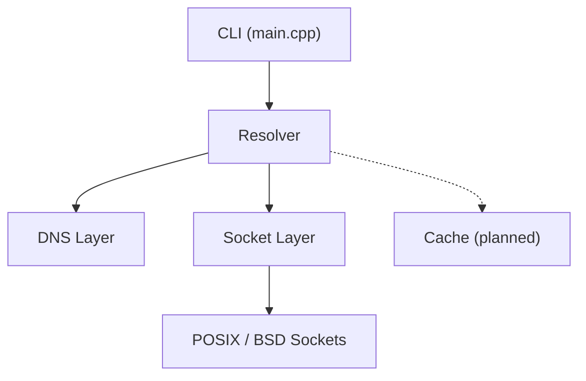

# DNS Resolver

A DNS stub resolver written in C++26, built from scratch using POSIX/BSD sockets and the DNS specifications in RFC 1034 and RFC 1035.

The project started as a way to explore network programming, binary protocols, and resource ownership in C++. Instead of using an existing DNS or networking library, it implements the socket layer, DNS wire format, and resolver directly.

The resolver sends queries to an upstream recursive DNS server (`1.1.1.1` by default). It handles query encoding, response parsing, name compression, timeouts, retries, and reply validation. It does not perform recursive DNS resolution itself, and caching isn't implemented yet.

## Usage

```text
DnsResolver <name> [server]
```

The CLI looks up A records for `name`, optionally using a specified upstream DNS server. Each answer is printed as its name, TTL, type, and address.

```console
$ ./DnsResolver www.amazon.com
www.amazon.com  1726  CNAME  (24 bytes)
tp.47cf2c8c9-frontier.amazon.com  46  CNAME  (5 bytes)
cf.47cf2c8c9-frontier.amazon.com  46  A  13.35.97.4
```

This response includes a CNAME chain returned by the upstream resolver. CNAME targets aren't decoded from RDATA yet, so the CLI displays their raw byte lengths. Actual records and TTLs will vary.

The resolver can also query DNS servers on a local network. For example, querying a hostname on my homelab through its gateway:

```console
$ ./DnsResolver core01.lab.alecmucz.com 10.0.10.1
core01.lab.alecmucz.com  300  A  10.10.10.3
```

Nonexistent domains print the response code instead of answers:

```console
$ ./DnsResolver nonexistent.invalid
NXDOMAIN
```

Timeouts and other resolver errors are written to stderr with a nonzero exit code.

## Architecture

The project is divided into three CMake libraries, keeping DNS protocol logic separate from the operating system's networking interfaces.



| Layer | Responsibility |
|---|---|
| [Socket Layer](include/socket/README.md) | IPv4/IPv6 addressing, UDP datagrams, receive timeouts, and RAII resource ownership. |
| [DNS Layer](include/dns/README.md) | RFC 1035 message encoding and parsing, including bounds-checked reads and name compression. |
| [Resolver](include/resolver/README.md) | Upstream query handling, per-attempt deadlines, retries, and response validation. |

## Building and Testing

### Requirements

- A POSIX-compatible system (developed on arm64 macOS). Windows isn't supported, since the socket layer uses BSD sockets directly.
- A C++26 compiler and standard library supporting `<print>`
- CMake 3.30 or newer

The project uses Apple Clang on macOS. Other toolchains may work but haven't been verified. On Linux, `<print>` needs a recent standard library (GCC 14+, or Clang with libc++ 17+).

### Build

```sh
cmake -S . -B build
cmake --build build
```

The executable is written to the repository root:

```sh
./DnsResolver example.com
```

### Testing

Catch2 is fetched automatically through CMake. Run the tests with:

```sh
ctest --test-dir build --output-on-failure
```

Unit tests cover domain name handling, query encoding, response parsing with compressed names, and truncated input. The resolver has also been checked manually against `dig` using public DNS and homelab queries.

For example, the same lookup through `DnsResolver` and `dig`, run a few seconds apart:

```console
$ ./DnsResolver www.google.com
www.google.com  289  A  142.251.157.119
www.google.com  289  A  142.251.156.119
www.google.com  289  A  142.251.154.119
www.google.com  289  A  142.251.155.119
www.google.com  289  A  142.251.151.119
www.google.com  289  A  142.251.153.119
www.google.com  289  A  142.251.150.119
www.google.com  289  A  142.251.152.119

$ dig @1.1.1.1 www.google.com A +noall +answer +nocmd
www.google.com.         285     IN      A       142.251.152.119
www.google.com.         285     IN      A       142.251.150.119
www.google.com.         285     IN      A       142.251.156.119
www.google.com.         285     IN      A       142.251.154.119
www.google.com.         285     IN      A       142.251.153.119
www.google.com.         285     IN      A       142.251.157.119
www.google.com.         285     IN      A       142.251.151.119
www.google.com.         285     IN      A       142.251.155.119
```

Both return the same eight addresses. The order changes between queries, and the TTLs differ slightly because they count down from when each cache fetched the record.

The tests don't provide exhaustive malformed-packet coverage or fuzzing.

## Limitations

The current implementation focuses on the core behavior of a DNS stub resolver, sticking mostly to the original 1987 RFCs. Several protocol features and safety improvements that later RFCs added remain unimplemented.

- **UDP only:** Uses a 512-byte receive buffer and rejects responses with the TC flag set. EDNS0 (RFC 6891) and TCP fallback (required by RFC 7766) are not implemented.
- **Fixed source port:** A `Resolver` reuses one socket and source port rather than randomizing the port for each query, as RFC 5452 recommends after the 2008 Kaminsky cache poisoning attack.
- **Compression loops:** The parser doesn't detect cyclic compression pointers, which can cause it to hang on crafted responses.
- **RDATA decoding:** Names embedded in CNAME and NS records are kept as raw bytes.
- **CLI:** Supports A record queries only and doesn't independently follow CNAME chains.
- **Concurrency:** A `Resolver` isn't thread-safe and should not be shared across threads making simultaneous queries.

## Next

- **Forwarding server:** Accept DNS queries from other machines on my homelab and forward them upstream.
- **TTL-aware LRU cache:** Cache responses according to their TTLs, with a benchmark comparing cached and uncached lookup latency.

## Learning Resources

The project has been developed alongside several networking and C++ references:

- *TCP/IP Illustrated, Volume 1* — Stevens & Fall
- [RFC 1034 — Domain Names: Concepts and Facilities](https://www.rfc-editor.org/rfc/rfc1034)
- [RFC 1035 — Domain Names: Implementation and Specification](https://www.rfc-editor.org/rfc/rfc1035)
- *Computer Networking: A Top-Down Approach* — Kurose & Ross
- [Beej's Guide to Network Programming](https://beej.us/guide/bgnet/)
- [cppreference](https://en.cppreference.com/)
- [C++ Weekly](https://www.youtube.com/@cppweekly)