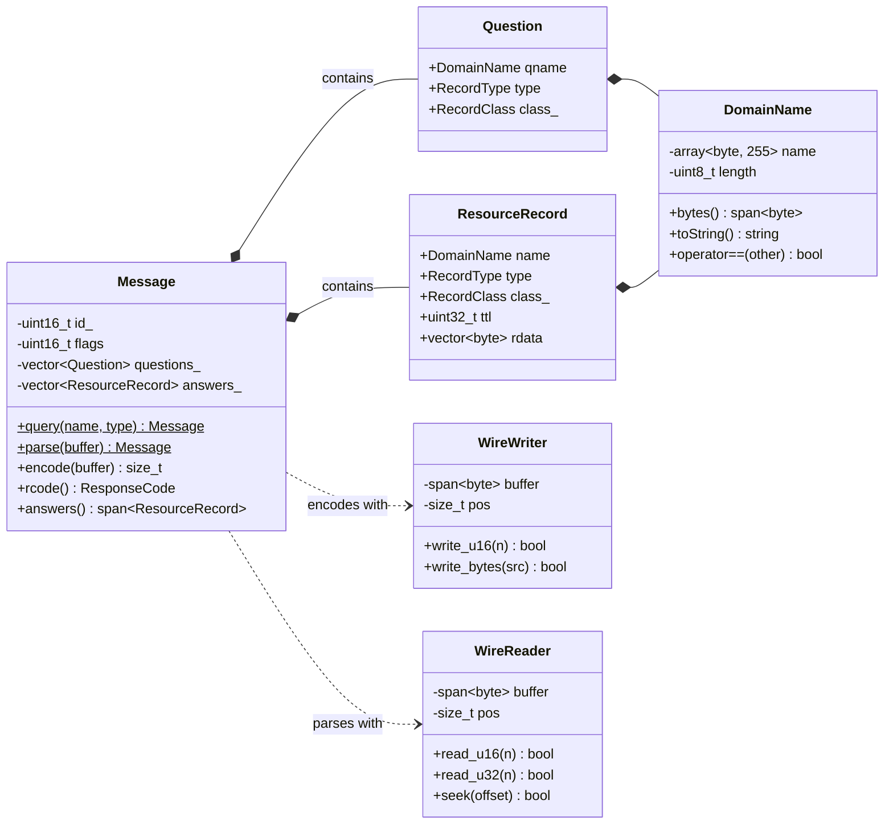
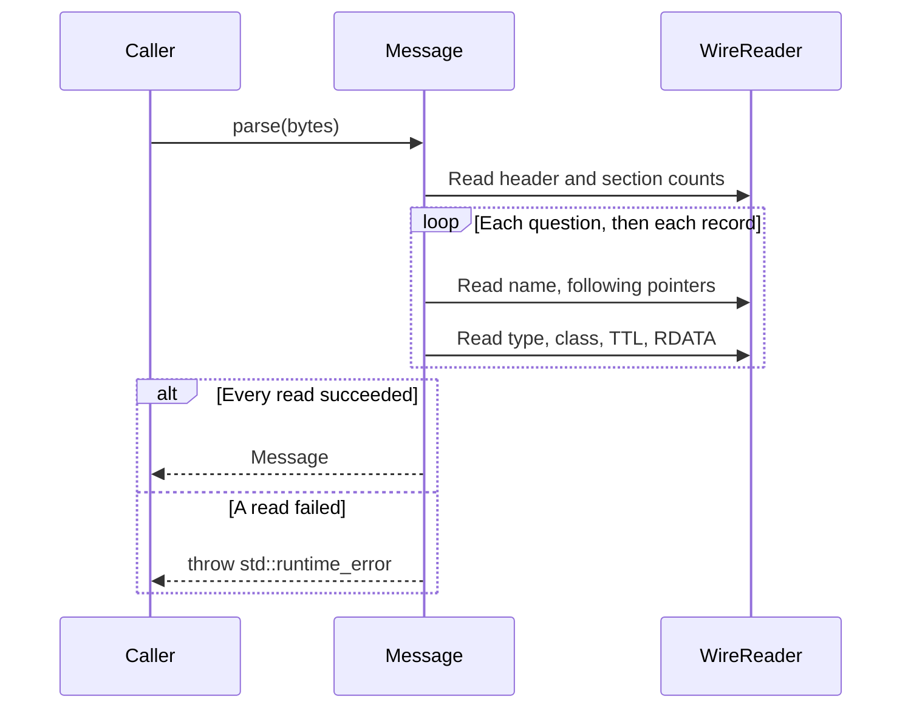

# DNS Layer

The DNS wire-format implementation for `DnsResolver`, based on RFC 1035. It builds queries, encodes them into bytes, and parses responses into C++ types. The layer operates on byte buffers independently of the socket API.

## Components

| Type | Responsibility |
|---|---|
| `Message` | Builds DNS queries, encodes messages, and parses responses. |
| `Question` | A DNS question containing a name, type, and class. |
| `ResourceRecord` | A resource record containing a name, type, class, TTL, and RDATA. |
| `DomainName` | Stores domain names in wire format, with validation and string conversion. |
| `WireWriter` / `WireReader` | Internal bounds-checked byte writer and reader (`src/dns/Wire.h`). |



## Wire Format

### Message Layout

A DNS message consists of a fixed 12-byte header followed by four variable-length sections (RFC 1035 §4.1).

```text
+---------------------+
|        Header       |  ID, flags, and section counts
+---------------------+
|       Question      |  Requested name, type, and class
+---------------------+
|        Answer       |  Answer records
+---------------------+
|      Authority      |  Authority records
+---------------------+
|      Additional     |  Additional records
+---------------------+
```

The header contains six 16-bit fields, including the flags packed into the second field:

```text
 0  1  2  3  4  5  6  7  8  9 10 11 12 13 14 15
+--+--+--+--+--+--+--+--+--+--+--+--+--+--+--+--+
|                       ID                      |
+--+--+--+--+--+--+--+--+--+--+--+--+--+--+--+--+
|QR|   Opcode  |AA|TC|RD|RA| Z|AD|CD|   RCODE   |
+--+--+--+--+--+--+--+--+--+--+--+--+--+--+--+--+
|                    QDCOUNT                    |
+--+--+--+--+--+--+--+--+--+--+--+--+--+--+--+--+
|                    ANCOUNT                    |
+--+--+--+--+--+--+--+--+--+--+--+--+--+--+--+--+
|                    NSCOUNT                    |
+--+--+--+--+--+--+--+--+--+--+--+--+--+--+--+--+
|                    ARCOUNT                    |
+--+--+--+--+--+--+--+--+--+--+--+--+--+--+--+--+
```

`Message` stores each section in a separate vector, exposed through read-only `std::span` accessors. Flags are stored as a `uint16_t` and accessed using bitmasks through methods such as `qr()`, `rd()`, `tc()`, and `rcode()`.


A response from 1.1.1.1 captured in Wireshark. Flags `0x8180` match the header layout above, and each answer starts with `c0 0c`, a compression pointer back to the name at offset 12.

## Implementation

### Wire Helpers

`WireWriter` and `WireReader` provide bounds-checked operations on byte buffers, returning `false` when an operation exceeds the available space. Multi-byte integers use network byte order. Both types are internal to the DNS layer.

### Domain Names

`DomainName` stores names as length-prefixed labels terminated by a zero byte. For example, `www.example.com` is represented as:

```text
[3]www[7]example[3]com[0]
```

Each bracketed value represents a single-byte label length.

Construction validates label and name lengths, throwing `std::invalid_argument` for invalid input. The root domain is represented by `"."`, and `toString()` converts names back to dotted form.

Equality is case-insensitive for ASCII letters, allowing the resolver to compare names when validating responses.

### Message Operations

`Message` provides three main operations:

- `query()` — builds a query with a randomized 16-bit transaction ID and the recursion-desired flag set.
- `encode()` — writes the header and question section into a buffer, returning the bytes written or `0` if the buffer is too small.
- `parse()` — reads a DNS message from a buffer, including its questions and resource records.

Transaction IDs are generated using `std::random_device` and used by the resolver to match replies to requests.

### Response Parsing

`Message::parse()` reads the header, then processes each section according to its record count.



DNS name compression allows a name to reference another position in the packet through a two-byte pointer. `read_name()` follows these pointers to reconstruct the name, then restores the reader's position after the original pointer.

Invalid label encodings and failed reads cause parsing to throw. Resource record RDATA is preserved as raw bytes.

## Example

Building and encoding a DNS query:

```cpp
auto query = dns::Message::query(
    dns::DomainName{"example.com"},
    dns::RecordType::A
);

std::array<std::byte, 512> buffer{};
std::size_t length = query.encode(buffer);
```

The encoded bytes can be sent through the socket layer. A received response can then be parsed and inspected:

```cpp
auto response = dns::Message::parse(received_bytes);

for (const auto& record : response.answers()) {
    // record.name, record.type, record.ttl, record.rdata
}
```

Here, `received_bytes` represents the received datagram as a `std::span<const std::byte>`.

## Limitations

The layer currently encodes queries and parses responses. Encoding answer records for DNS server responses is not implemented.

Known limitations include:

- **Compression loops:** Pointers are not checked for cycles, so a crafted packet can cause parsing to loop indefinitely.
- **RDATA decoding:** Names embedded in CNAME and NS records remain as raw bytes.
- **Error reporting:** Parsing errors are generic and do not identify the failed field.

The implementation focuses on the wire-format functionality needed by the stub resolver rather than the complete DNS protocol.
