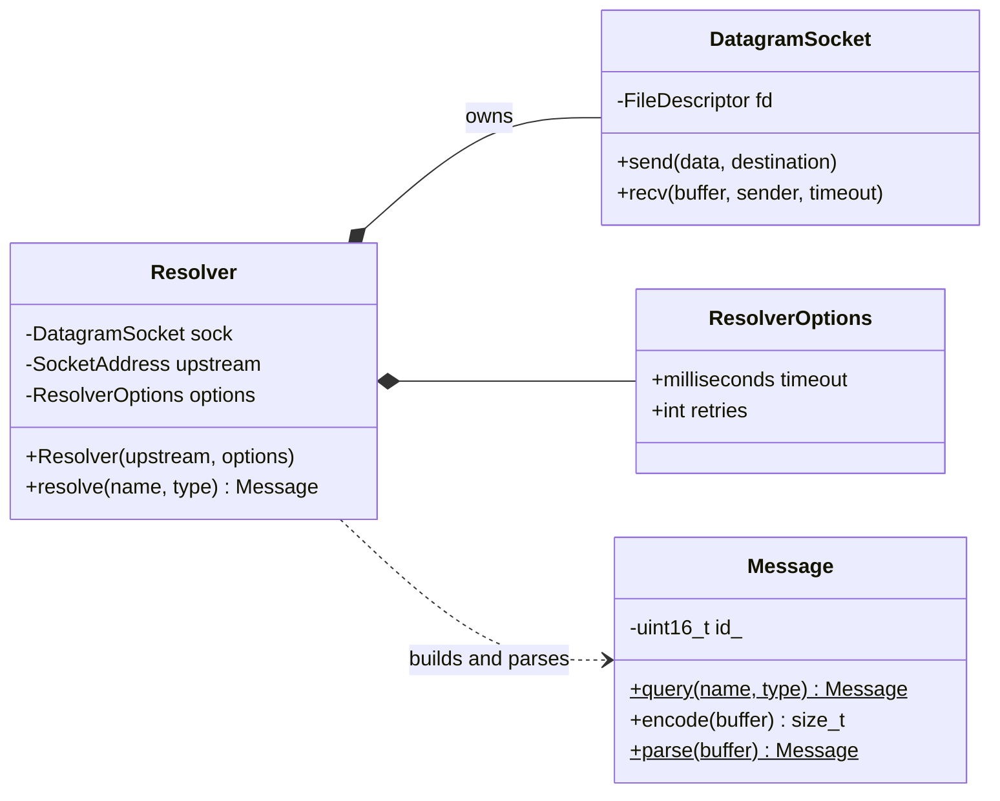
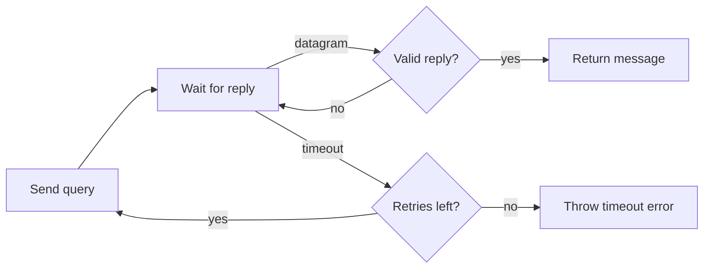

# Resolver

The stub resolver for `DnsResolver`. It connects the DNS layer to the socket layer: given a name and a record type, it builds a query, sends it to an upstream recursive resolver over UDP, waits for a matching reply, and returns the parsed response.

## Components

| Type | Responsibility |
|---|---|
| `Resolver` | Owns a UDP socket and the upstream address, and runs the query and response exchange. |
| `ResolverOptions` | Timeout per attempt (default 5 seconds) and number of retries (default 2). |



## Design

### One Socket, One Upstream

A `Resolver` is constructed with the upstream server's `SocketAddress` and creates one `DatagramSocket` of the matching address family. The same socket is reused for every query. The OS assigns an ephemeral source port on the first send, which remains fixed for the socket's lifetime.

### Resolve Loop

`resolve(name, type)` encodes the query once, then makes up to `retries + 1` attempts. Each attempt sends the same bytes with the same ID and waits until a valid reply arrives or the attempt's deadline passes.



The deadline is computed once per attempt with `std::chrono::steady_clock`, and each `recv()` is given only the time remaining. Ignored datagrams don't reset the deadline.

### Reply Validation

A datagram only counts as a reply if it:

- comes from the upstream address and port
- parses as a DNS message
- has the same ID as the query
- has the QR (response) flag set
- repeats the question that was asked: same name, type, and class

Replies that fail these checks are ignored, and the resolver continues waiting within the current deadline. These checks follow the response-matching guidance in RFC 1035 §7.3.

### Results and Errors

`resolve()` returns the parsed `Message` without interpreting its response code. Responses such as `NXDOMAIN` and `SERVFAIL` are returned to the caller rather than thrown as exceptions.

The resolver throws `std::runtime_error` when all attempts time out or when a valid response has the TC (truncated) flag set. Socket errors may also propagate from the underlying socket layer.

## Example

```cpp
auto upstream = IpAddress::parse("1.1.1.1");

dns::Resolver resolver{SocketAddress{*upstream, 53}, {}};
auto response = resolver.resolve(dns::DomainName{"example.com"}, dns::RecordType::A);

if (response.rcode() == dns::ResponseCode::NoError) {
    for (const auto& record : response.answers()) {
        // Process records
    }
}
```

## Limitations

- **UDP only:** Uses a 512-byte receive buffer and rejects responses with the TC flag set. TCP fallback is not implemented.
- **Fixed source port:** Every query from a `Resolver` uses the same port. Source-port randomization is recommended by RFC 5452.
- **No CNAME following:** The resolver returns whatever records the upstream sent and doesn't chase CNAMEs itself.
- **Not thread-safe:** Two threads sharing one `Resolver` could read each other's replies. Use one per thread.