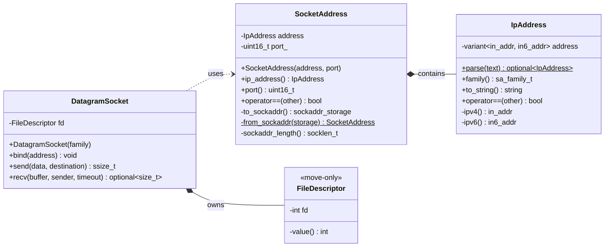
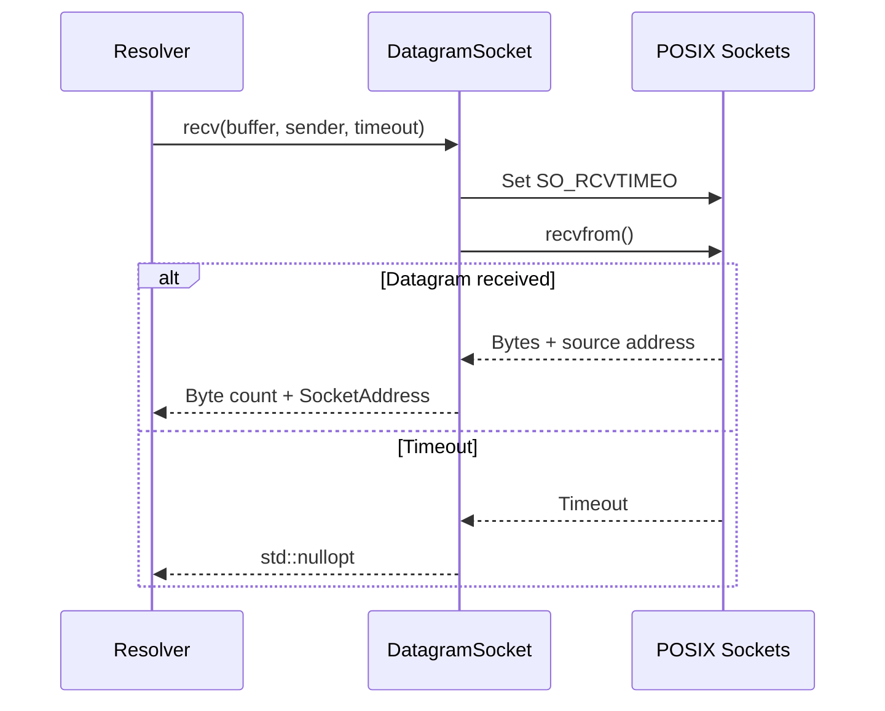

# Socket Layer

A small C++ networking layer built on POSIX/BSD sockets for `DnsResolver`. It handles native socket operations, address conversions, and resource ownership so the DNS and resolver code can work with C++ types instead of operating-system interfaces.

## Components

| Type | Responsibility |
|---|---|
| `IpAddress` | Represents IPv4 and IPv6 addresses, with parsing and string conversion. |
| `SocketAddress` | Combines an IP address with a port and handles native address conversion. |
| `DatagramSocket` | Provides UDP socket operations for sending and receiving datagrams. |
| `FileDescriptor` | Internal RAII wrapper managing native file descriptor ownership. |



## Design

### Resource Ownership

`FileDescriptor` is a move-only RAII wrapper that closes its native descriptor on destruction. Copying is disabled to prevent multiple objects from owning the same descriptor, while moving transfers ownership safely.

`DatagramSocket` contains a `FileDescriptor`, separating resource ownership from networking operations. Callers don't need to manage native descriptors or call `close()` manually.

### Address Representation

The address model is partly inspired by Java's `InetAddress`, `InetSocketAddress`, and `DatagramSocket`, adapted to C++ with RAII, move semantics, and POSIX interoperability.

`IpAddress` represents either an IPv4 or IPv6 address. It provides parsing from text and conversion back to string form, hiding the underlying `in_addr` and `in6_addr` representations.

`SocketAddress` pairs an `IpAddress` with a port and handles conversion to and from native `sockaddr` structures. Ports are stored in host byte order and converted at the POSIX boundary using `htons()` and `ntohs()`.

Both address types support equality comparisons. The resolver uses `SocketAddress` equality when verifying that a DNS response came from the expected upstream server.

## DatagramSocket

`DatagramSocket` provides three operations:

- `bind()` — associates a socket with a local address.
- `send()` — sends a UDP datagram to a destination.
- `recv()` — receives a datagram into a caller-provided buffer, with a timeout.

Buffers are passed using `std::span`, avoiding additional buffer ownership within the socket layer.

### Receiving Datagrams

`recv()` returns `std::optional<std::size_t>`. A successful receive returns the number of bytes written into the buffer; an expired timeout returns `std::nullopt`.

The timeout is applied using `SO_RCVTIMEO` on each call, allowing the resolver to supply the remaining time before its deadline.



Other socket failures throw `std::system_error`, preserving the underlying OS error code. Unsupported address families passed to the constructor throw `std::invalid_argument`.

### Example

A simple UDP echo using the socket interface:

```cpp
auto ip = IpAddress::parse("127.0.0.1");
if (!ip) {
    return 1;
}

DatagramSocket server{AF_INET};
server.bind(SocketAddress{*ip, 9000});

std::array<std::byte, 1024> buffer{};
std::optional<SocketAddress> sender;

using namespace std::chrono_literals;

auto received = server.recv(buffer, sender, 5s);
if (!received) {
    return 1;
}

server.send(std::span{buffer}.first(*received), *sender);
```

The socket layer handles the native descriptors, address conversions, and system calls internally.

## Scope

This layer supports UDP over IPv4 and IPv6 on POSIX systems. TCP sockets, Windows support, and asynchronous I/O are outside its current scope.

It is designed around the needs of `DnsResolver`, rather than as a general-purpose networking library.